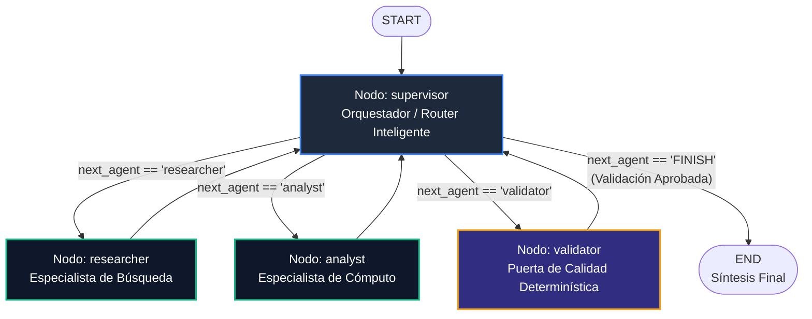

# Pre-entrega 6: Orquestador Multi-Agente Especializado con Topología Jerárquica

Sistema multi-agente construido con **LangGraph**, **LangChain**, **Pydantic** y **Python 3.12+**. Implementa el **Patrón Supervisor** para la delegación dinámica entre agentes especialistas, estado compartido estructurado con aislamiento de escritura y una **Puerta de Calidad determinística** para resolución de conflictos.

---

## 📋 Tabla de Contenidos

1. [Descripción del Proyecto](#descripción-del-proyecto)
2. [Topología y Justificación Arquitectónica](#topología-y-justificación-arquitectónica)
3. [Diagrama del Grafo](#diagrama-del-grafo)
4. [Roles y Especialistas del Sistema](#roles-y-especialistas-del-sistema)
5. [Contratos de Interfaz y Aislamiento de Escritura](#contratos-de-interfaz-y-aislamiento-de-escritura)
6. [Puerta de Calidad y Resolución de Conflictos](#puerta-de-calidad-y-resolución-de-conflictos)
7. [Estructura del Repositorio](#estructura-del-repositorio)
8. [Requisitos Previos](#requisitos-previos)
9. [Instalación y Configuración](#instalación-y-configuración)
10. [Ejecución del Sistema](#ejecución-del-sistema)
11. [Ejecución de Pruebas Unitarias](#ejecución-de-pruebas-unitarias)
12. [Evidencia de la Traza de Ejecución](#evidencia-de-la-traza-de-ejecución)
13. [Criterios de Evaluación y Cumplimiento de Rúbrica](#criterios-de-evaluación-y-cumplimiento-de-rúbrica)

---

## 🎯 Descripción del Proyecto

Cuando un problema excede la capacidad cognitiva de un único agente o un solo prompt, se requiere una arquitectura de **Sistemas Multi-Agente (MAS)**. Este proyecto resuelve la auditoría técnica de infraestructura y diagnóstico de incidentes mediante una organización de agentes coordinados por un **Supervisor**, donde:

- **Ningún agente hace el trabajo del otro:** Cada especialista cuenta con herramientas funcionales acotadas y un contrato Pydantic estricto.
- **El Supervisor coordina y no ejecuta:** Analiza el estado, delega a los especialistas y produce la síntesis ejecutiva final únicamente tras la aprobación de calidad.
- **Aislamiento de Escritura en el Estado Compartido:** Cada nodo escribe exclusivamente en su campo designado del `MultiAgentState`, previniendo condiciones de carrera (*Race Conditions*) y sobrescritura accidental.
- **Puerta de Calidad Determinística:** Código Python determinístico verifica los cálculos antes de aceptar la respuesta (*"Pydantic, no vibras"*). Si hay incongruencias matemáticas o saturación de hardware no informada, el sistema detecta el conflicto y escala a supervisión humana.

---

## 🏛️ Topología y Justificación Arquitectónica

### ¿Por qué Topología Jerárquica (Supervisor) sobre Cooperativa (Peer-to-Peer)?

1. **Control Centralizado y Auditoría:** La jerarquía permite trazar exactamente qué agente decidió qué y por qué en un único punto de gobierno (supervisor), facilitando la depuración en producción.
2. **Eliminación del Caos Emergente:** En arquitecturas puramente cooperativas (sin líder), los agentes pueden entrar en bucles infinitos de auto-corrección sin convergencia. El Supervisor cuenta con un contador de iteraciones de seguridad (techo de 6 pasos) que garantiza la finalización.
3. **Especialización y Eficiencia de Tokens:** Cada especialista recibe únicamente el contexto mínimo que necesita para su tarea (sin contaminar con todo el historial), reduciendo el consumo innecesario de tokens.
4. **Validación Formal:** La inclusión de un nodo determinístico de validación asegura que el flujo no pase a la síntesis final hasta que los artefactos cumplan las reglas matemáticas de negocio.

---

## 📊 Diagrama del Grafo



---

## 🤖 Roles y Especialistas del Sistema

### 1. Supervisor (`agents/supervisor.py`)
- **Rol:** Director de orquesta.
- **Herramienta de Decisión:** `llm.with_structured_output(SupervisorRoute)`.
- **Comportamiento:** Decide secuencialmente convocar al `researcher`, luego al `analyst`, luego al `validator`. Si el validador aprueba, emite la síntesis final y finaliza el flujo hacia `END`.

### 2. Agente de Búsqueda / Investigación (`agents/research_agent.py`)
- **Dominio:** Telemetría e infraestructura.
- **Herramienta funcional:** `query_cluster_metrics(cluster_id: str)`.
- **Salida:** `ResearchArtifact` (nodos activos/totales, peticiones/h, errores/h, CPU %, memoria %, logs de incidentes, `confidence_score`).

### 3. Agente de Análisis / Cómputo (`agents/analyst_agent.py`)
- **Dominio:** Métricas cuantitativas y cálculo de SLA/estrés.
- **Herramientas funcionales:**
  - `calculate_availability_score(total_requests, error_requests)`.
  - `calculate_resource_stress_index(cpu_pct, memory_pct)`.
- **Salida:** `AnalysisArtifact` (tasa de disponibilidad, índice de estrés ponderado, clasificación de riesgo BAJO/MEDIO/ALTO/CRITICO, conclusiones, `confidence_score`).

### 4. Puerta de Calidad / Validador Determinístico (`agents/validator.py`)
- **Rol:** Control estricto de veracidad y consistencia cruzada.
- **Lógica:** Python puro sin LLM. Comprueba rangos de confianza, consistencia matemática de fórmulas y ausencia de contradicciones lógicas.
- **Salida:** `ValidationArtifact` (`valido`, `conflictos_detectados`, `requiere_escalacion_humana`, `observaciones`).

---

## 📋 Contratos de Interfaz y Aislamiento de Escritura

El estado compartido está definido en `state.py`:

```python
class MultiAgentState(MessagesState):
    task_description: str
    next_agent: str
    iterations: int
    researcher_output: ResearchArtifact | None   # Exclusivo de ResearchAgent
    analyst_output: AnalysisArtifact | None        # Exclusivo de AnalystAgent
    validation_output: ValidationArtifact | None  # Exclusivo de Validador
```

**Regla de aislamiento:** Ningún especialista modifica las claves de otro. Esto elimina los riesgos del antipatrón *Shared Mutable State*.

---

## 🛡️ Puerta de Calidad y Resolución de Conflictos

El validador aplica las siguientes reglas determinísticas:
1. **Existencia de datos:** Ambos artefactos (`researcher_output` y `analyst_output`) deben estar instanciados.
2. **Rango de confianza:** `0.0 <= confidence_score <= 1.0`.
3. **Consistencia numérica:** El cálculo de disponibilidad reportado en `AnalysisArtifact` debe coincidir con la fórmula matemática sobre los datos brutos de `ResearchArtifact`.
4. **Detección de contradicciones:** Si la utilización de hardware supera el 85% pero el analista clasificó el riesgo como BAJO o MEDIO, se levanta una bandera de contradicción y se activa `requiere_escalacion_humana = True`.

---

## 📁 Estructura del Repositorio

```
.
├── agents/
│   ├── analyst_agent.py     # Agente Especialista en Análisis/Cómputo
│   ├── research_agent.py    # Agente Especialista en Búsqueda/Investigación
│   ├── supervisor.py        # Nodo Supervisor con with_structured_output y síntesis
│   └── validator.py         # Nodo de Validación Determinística de Calidad
├── .env.example             # Variables de entorno requeridas
├── .gitattributes           # Configuración de normalización de saltos de línea LF
├── .gitignore               # Exclusión de credenciales y archivos temporales
├── graph.py                 # Construcción y compilación de StateGraph con nodos y condicionales
├── main.py                  # Script asíncrono (.astream) de ejecución del orquestador
├── multi_agent_trace.json   # Traza completa de la ejecución en formato JSON
├── multi_agent_trace.log    # Traza legible de la ejecución en formato texto plano
├── README.md                # Documentación del sistema y justificación de topología
├── requirements.txt         # Dependencias Python (>=3.12)
├── state.py                 # Esquema del Estado Compartido y Contratos Pydantic
└── test_multi_agent.py      # Suite de pruebas unitarias locales (8 tests)
```

---

## ⚙️ Requisitos Previos

- **Python 3.12 o superior**
- **Git**
- Clave de API de OpenAI (`OPENAI_API_KEY`)

---

## 🚀 Instalación y Configuración

### 1. Clonar el repositorio
```bash
git clone https://github.com/thomilopez/AI-Engineering---Pre-Entrega-6.git
cd AI-Engineering---Pre-Entrega-6
```

### 2. Crear y activar entorno virtual (Python 3.12+)
En Windows (PowerShell):
```powershell
python -m venv venv
.\venv\Scripts\Activate.ps1
```

En Linux / macOS:
```bash
python3 -m venv venv
source venv/bin/activate
```

### 3. Instalar dependencias
```bash
pip install --upgrade pip
pip install -r requirements.txt
```

### 4. Configurar variables de entorno
```bash
cp .env.example .env
```

Completar `.env` con la API key de OpenAI:
```ini
OPENAI_API_KEY=sk-tu-api-key-de-openai-aqui
MODEL_NAME=gpt-4o-mini
```

---

## ▶️ Ejecución del Sistema

Para ejecutar el orquestador multi-agente completo:

```bash
python main.py
```

Durante la ejecución, `main.py` utiliza streaming asíncrono (`graph.astream`) para mostrar en tiempo real la activación de cada nodo, la toma de decisiones del supervisor, la emisión de artefactos y la síntesis final.

Al concluir, genera automáticamente:
- `multi_agent_trace.json`: Traza estructurada de cada paso en formato JSON.
- `multi_agent_trace.log`: Registro completo y legible de la ejecución.

---

## 🧪 Ejecución de Pruebas Unitarias

El proyecto incluye 8 pruebas unitarias automatizadas con `unittest` que se ejecutan localmente sin consumir tokens de LLM:

```bash
python test_multi_agent.py
```

### Cobertura de pruebas:
- `test_01_estado_hereda_messages_state`: Valida herencia de `MessagesState` para soporte de reducers.
- `test_02_contrato_research_artifact`: Valida tipos y rangos de Pydantic en `ResearchArtifact`.
- `test_03_contrato_analysis_artifact`: Valida categorización de riesgo en `AnalysisArtifact`.
- `test_04_herramienta_researcher_metricas`: Valida la consulta de telemetría de clústeres.
- `test_05_herramientas_analyst_calculos`: Valida cálculos exactos de disponibilidad y estrés.
- `test_06_validador_deterministico_aprobado`: Valida el escenario de aprobación de calidad.
- `test_07_validador_detecta_conflicto_y_contradicion`: Valida la detección de conflictos y escalación humana.
- `test_08_topologia_del_grafo`: Valida la existencia y conectividad de los 4 nodos en el `StateGraph`.

---

## 📝 Evidencia de la Traza de Ejecución

Extracto de la traza real registrada en `multi_agent_trace.log` y `multi_agent_trace.json`:

```
================================================================================
TRAZA DE EJECUCIÓN MULTI-AGENTE: DELEGACIÓN JERÁRQUICA Y ESTADO COMPARTIDO
================================================================================
Consulta Inicial: Realizar una auditoría técnica completa del clúster de producción 'cloud-cluster-prod': recolectar telemetría de fallos y nodos, calcular disponibilidad y estrés de recursos, validar consistencia de datos y emitir informe de recomendaciones operativas.

--- [PASO 1] NODO EJECUTADO: 'SUPERVISOR' ---
  Mensaje: [SUPERVISOR]: Delegando a 'researcher'. Motivo: Falta la información base de infraestructura. Se delega al ResearchAgent.
  [Supervisor] Próxima delegación decidida: 'researcher'.

--- [PASO 2] NODO EJECUTADO: 'RESEARCHER' ---
  Mensaje: [ResearchAgent]: Investigación completada sobre 'Auditar clúster cloud-cluster-prod'. Nodos activos: 22/24. Peticiones/h: 850000. Errores/h: 4250. CPU: 88.4%, Memoria: 91.2%. Confidence: 0.95.
  [Artifact] ResearchArtifact generado (confidence=0.95).

--- [PASO 3] NODO EJECUTADO: 'SUPERVISOR' ---
  Mensaje: [SUPERVISOR]: Delegando a 'analyst'. Motivo: Investigación disponible. Se delega al AnalystAgent para cómputo numérico y análisis de riesgo.
  [Supervisor] Próxima delegación decidida: 'analyst'.

--- [PASO 4] NODO EJECUTADO: 'ANALYST' ---
  Mensaje: [AnalystAgent]: Cómputo completado. Métrica: Disponibilidad y Tasa de Error = 99.5%. Estrés de recursos: 90.08/100 (CRITICO). Riesgo: CRITICO. Conclusiones: Disponibilidad calculada en 99.50% cumpliendo formalmente con el SLA mínimo; El índice de estrés de recursos ponderado alcanza 90.08 sobre 100, situándose en categoría CRÍTICA.
  [Artifact] AnalysisArtifact generado (riesgo=CRITICO, score=0.98).

--- [PASO 5] NODO EJECUTADO: 'SUPERVISOR' ---
  Mensaje: [SUPERVISOR]: Delegando a 'validator'. Motivo: Artefactos de investigación y análisis listos. Se delega al Validador para control determinístico.
  [Supervisor] Próxima delegación decidida: 'validator'.

--- [PASO 6] NODO EJECUTADO: 'VALIDATOR' ---
  Mensaje: [ValidationGate]: Estado: APROBADO. Conflictos: Ninguno. Escalación Humana: False. Observaciones: Validación determinística exitosa: métricas, fórmulas y artefactos completamente coherentes.
  [Artifact] ValidationArtifact generado (valido=True, conflictos=[]).

--- [PASO 7] NODO EJECUTADO: 'SUPERVISOR' ---
  [Supervisor] Próxima delegación decidida: 'FINISH'.
  Mensaje: [SUPERVISOR - SÍNTESIS FINAL]:
  INFORME EJECUTIVO DE AUDITORÍA TÉCNICA: CLÚSTER 'CLOUD-CLUSTER-PROD'
  1. Estado Operativo: 22 de 24 nodos operativos (2 nodos inoperativos por incidentes de memoria OOM).
  2. Métricas Cuantitativas: 850.000 peticiones procesadas con 99.50% de disponibilidad (cumplimiento de SLA).
  3. Diagnóstico de Riesgo: Clasificación CRÍTICA con un índice de estrés ponderado de 90.08/100 (CPU al 88.4% y Memoria al 91.2%).
  4. Dictamen de Calidad: Validación determinística aprobada. No se encontraron discrepancias matemáticas ni contradicciones lógicas.
  5. Recomendaciones Operativas:
     - Realizar escalado horizontal inmediato añadiendo 6 nodos en us-east-1.
     - Implementar reinicio controlado y profiling de memoria en servicios con fugas antes del próximo pico de tráfico.

================================================================================
FLUJO COMPLETADO CON ÉXITO
================================================================================


